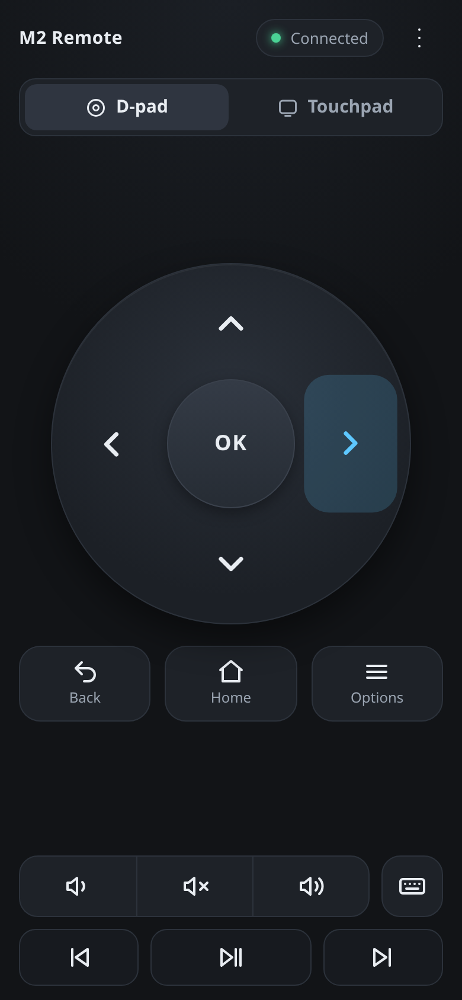
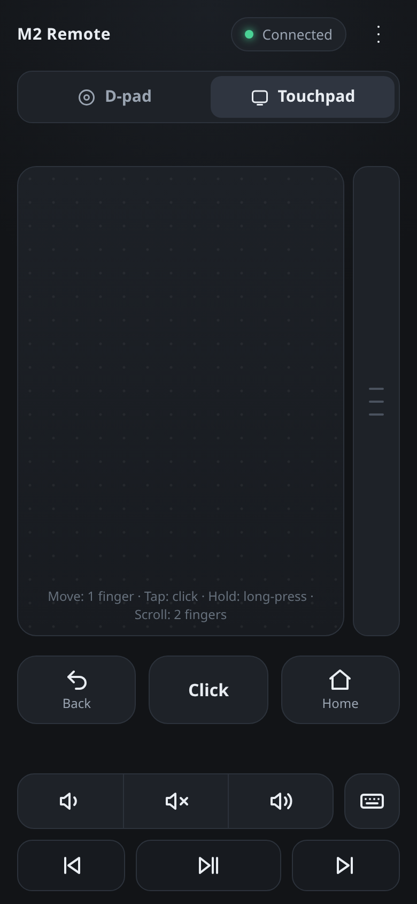
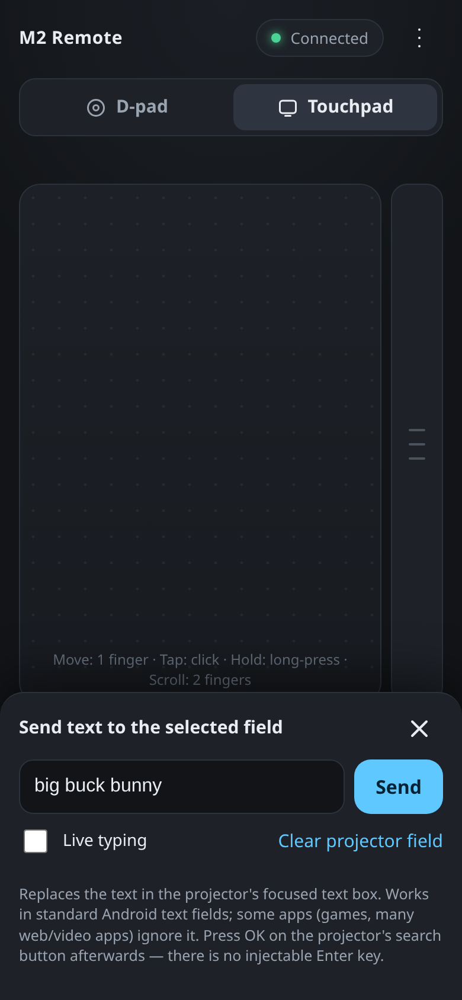
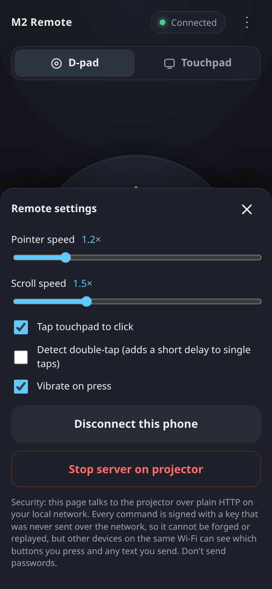
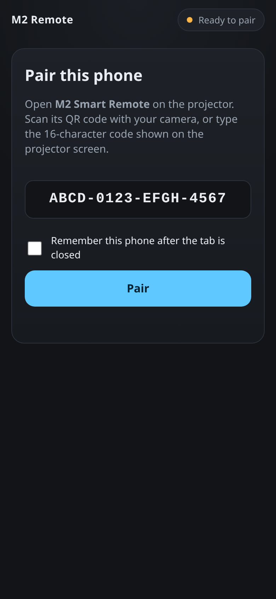

# M2 Smart Remote

A local Wi-Fi remote for the **TI M2 Smart projector** (Android 7.1.2 / API 25, Rockchip RK3128,
32-bit ARM, ~1 GB RAM). It has two parts:

- **The projector APK** (Java, 84 KB release build). It runs a small HTTP server on the projector's
  LAN address and turns your commands into actions through an Android Accessibility Service.
- **The phone remote**, a plain HTML/CSS/JS page served by the projector itself. Open
  `http://PROJECTOR_IP:8765/` in Chrome, pair once, and use it. You don't need to install
  anything on the phone.

There is no cloud, no account, no analytics, and no internet access required.

## Screenshots

The phone remote in Chrome (portrait, one-handed):

| D-pad | Touchpad | Text entry | Settings | Pairing |
|:---:|:---:|:---:|:---:|:---:|
|  |  |  |  |  |

```
 Phone (Chrome)                                 Projector (Android 7.1.2)
 ┌──────────────┐  signed JSON over LAN HTTP   ┌──────────────────────────────────────────┐
 │ index.html   │ ───────────────────────────▶ │ RemoteService (foreground)               │
 │ app.js       │   POST /api/command {UP}     │  └ RemoteServer (NanoHTTPD, LAN IP only) │
 │ crypto.js    │ ◀─────────────────────────── │     ├ OriginPolicy / RateLimiter         │
 └──────────────┘   {"ok":true}                │     ├ RequestAuthenticator (HMAC)        │
                                               │     └ CommandRouter (allowlist)          │
                                               │         ├ AccessibilityController ──▶ RemoteAccessibilityService
                                               │         └ AudioController (AudioManager) │
                                               └──────────────────────────────────────────┘
```

## What works, and how

| Feature | Mechanism | Needs accessibility? |
|---|---|---|
| Up / Down / Left / Right | The app's own focus search, or "virtual focus" with an on-screen highlight | Yes |
| OK | Clicks the focused item; falls back to tapping its centre | Yes |
| Back, Home | `performGlobalAction` | Yes |
| Options (Menu) | **Long-presses** the selected item. A real MENU key cannot be injected | Yes |
| Touchpad: move, tap, double-tap, long-press, 2-finger scroll | Overlay cursor plus `dispatchGesture` (touch emulation, not a mouse) | Yes |
| Text entry | `ACTION_SET_TEXT` on the focused text field, falling back to clipboard paste | Yes |
| Volume up/down, mute | `AudioManager.adjustStreamVolume` | No |
| Play/pause, next, previous | `AudioManager.dispatchMediaKeyEvent` to the active media app | No |

What it **cannot** do with a normal APK on Android 7: inject real key events (DPAD/ENTER/MENU),
move the system mouse pointer, or control apps that draw their UI without accessibility nodes
(many games and some video players). See [docs/REPORT.md](docs/REPORT.md#known-limitations).

## Quick start

```bash
./gradlew assembleDebug          # JDK 17 + Android SDK; see docs/BUILD.md
adb install -r app/build/outputs/apk/debug/app-debug.apk
```

1. Open **M2 Smart Remote** on the projector.
2. Select **Enable accessibility service** and turn on *M2 Smart Remote*.
3. Scan the QR code on the projector with your phone camera, or open the address shown and type the
   code.

## Documentation

- [docs/BUILD.md](docs/BUILD.md): toolchain, debug and release builds
- [docs/INSTALL.md](docs/INSTALL.md): installing on the projector, pairing and first test
- [docs/TROUBLESHOOTING.md](docs/TROUBLESHOOTING.md): common failures and diagnostic commands
- [docs/TESTING.md](docs/TESTING.md): automated tests and the manual test matrix for the real projector
- [docs/REPORT.md](docs/REPORT.md): architecture, API, security model, limitations, extending
